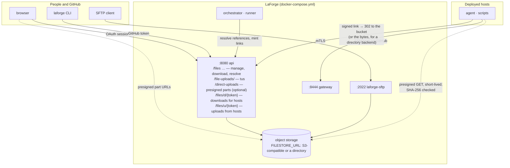

# Plan: the file store, on the 3.0 architecture

**Status:** proposal for `3.0`. **Written:** 2026-10-12, against `3.0` at `2227c778`.

LaForge stays one deployment — api, orchestrator, runner, gateway, Postgres, in one
compose stack — and gains a place to keep the files content uses, ways to get files in,
a way for hosts to fetch them, and a way for hosts to send files back. This supersedes
§9 of [site-split-and-file-store.md](site-split-and-file-store.md) for `3.0`; nothing
here depends on that plan's cloud/site split.

## Contents

1. [What it is for](#1-what-it-is-for)
2. [Shape](#2-shape)
3. [Storage and data model](#3-storage-and-data-model)
4. [Getting files in](#4-getting-files-in)
5. [Getting files to hosts](#5-getting-files-to-hosts)
6. [Getting files back from hosts](#6-getting-files-back-from-hosts)
7. [Configuration](#7-configuration)
8. [Security](#8-security)
9. [Operations](#9-operations)
10. [Phases](#10-phases)
11. [Open decisions](#11-open-decisions)

## 1. What it is for

A place to keep files that content uses — installers, tool archives, disk images,
datasets, wordlists, Compose project assets — from a few KB to several GB:

- **Uploaded once**, through the UI, the CLI or SFTP, resuming when a connection drops.
- **Managed in the UI**: versions, rename, soft delete and restore, who did what, what
  content uses each file, how much each repository holds.
- **Referenced from content by name**: `download: { file: tools/nmap.tgz }` in a step,
  `{{ file "wordlists/rockyou.txt" }}` in a script. Validated when content is pushed, so a
  build never starts with a reference to a file that isn't there.
- **Fetched by hosts** over a signed link that only works for that build.
- **Sent back by hosts**: the `upload:` step (today "not implemented — no file store
  yet" in `internal/gateway/steps.go`) puts logs, generated credentials and evidence into
  the file store under the build, one-time links only, never at a player's initiative.

Not in scope here: anything that needs a second machine (on-site caches, replication).

## 2. Shape



Two new things listen: the api gains the file routes, and `laforge-sftp` is a new small
service on 2022 (optional; leave it out of the stack if nobody wants SFTP). Hosts already
reach the api today for their agent binary (`API_PUBLIC_URL`); download and upload links
use the same address. Bytes themselves go to and from the bucket directly wherever the
backend allows it (§5): the api authorises, the bucket serves. Nothing new is published.

## 3. Storage and data model

**Bytes** live in object storage behind one abstraction (`gocloud.dev/blob`), keyed by
content: `sha256/<first 2>/<sha256>`. Identical uploads are stored once; renames are
free; everything a host fetches is verifiable. `FILESTORE_URL` picks the backend:

| Backend | `FILESTORE_URL` |
| --- | --- |
| S3-compatible (AWS, R2, B2, MinIO, SeaweedFS) | `s3://bucket?region=…&endpoint=…&use_path_style=true` plus `AWS_ACCESS_KEY_ID` / `AWS_SECRET_ACCESS_KEY` |
| Azure Blob | `azblob://container` plus `AZURE_STORAGE_ACCOUNT` / `AZURE_STORAGE_KEY` |
| A directory (development, small deployments) | `file:///var/lib/laforge/files` |

**Names** live in Postgres:

| Table | What |
| --- | --- |
| `file_blob` | one row per distinct content: sha256, size; garbage-collected once nothing references it |
| `file` | a named file in a **scope** — `repository_id` NULL is `global`, else that repository's — with a path unique (case-insensitively) among the scope's live files; description; soft-delete columns |
| `file_version` | each upload to a path adds one; the highest is current; sha256, size, content type, who, when |
| `file_upload` | an upload in progress: via `tus`, `sftp` or `direct`, scope and path, bytes so far, expiry; the api and the sftp service each resume and expire only their own |
| `file_event` | everything that happened to a file (upload, rename, delete, restore, version restore), for the file's history |
| `file_reference` | which files each content revision references (`download: { file }`, `{{ file }}`), with the pinned version or 0 for current; recorded at validation. Answers "used by" and protects a referenced version from pruning |
| `file_delivery_key` | the HMAC key that signs host download links; one row, made on first use |
| `host_upload` | an `upload:` step's grant: grant id, build, destination path, sha256 and size once received; one row per grant, so a used link takes nothing more |

**Scopes and permissions.** Instance admins manage `global`; a repository's `manage`
level manages its scope; anyone with `read` on a repository sees and downloads its files
and `global` ones. Resolution from content: the repository's own scope first, then
`global`.

**Versions.** `FILESTORE_KEEP_VERSIONS` (default 5) older versions are kept per file, plus
any version that live content pins by `path@N`. A deleted file is kept
`FILESTORE_DELETED_RETENTION_DAYS` (30) for restore, then purged; blobs are collected when
no version references them.

**Quotas.** `FILESTORE_MAX_FILE_SIZE` (50 GiB) per file; `FILESTORE_SCOPE_QUOTA` per scope
(0 = none), checked before an upload starts *and* when it completes — host uploads
included (a host can't fill the store).

## 4. Getting files in

**tus over HTTP — the UI and the CLI.** `POST /file-uploads/` (tus 1.0.0, the `tusd`
library) with `Upload-Metadata` carrying scope, path and the file's SHA-256. Bytes are
staged on the api's disk (`FILESTORE_STAGING_DIR`), so a dropped connection resumes from
the server's `Upload-Offset`; once complete, the file is hashed, checked against the
client's hash and copied into object storage in the background (`finalizing`), and
`GET /file-uploads/{id}/status` says when the version exists. Staging keeps one code path
for every backend and keeps a multi-GB copy out of any single request a proxy could time
out.

- **UI**: a drag-and-drop uploader with progress, pause and resume; an upload's id is
  kept in `localStorage` under the file and destination, so choosing the same file again
  after a reload continues it.
- **CLI**: `laforge files put [scope:]path file` resumes the same way (`laforge files
  ls|get|rm|mv|versions|restore` round it out). `laforge check --online` asks the api
  (`POST /files/resolve`) that every reference in the content exists.

**Direct to the bucket — optional, S3 only.** With `FILESTORE_DIRECT_UPLOADS=true` the
browser uploads parts straight to the bucket through presigned multipart URLs
(`/direct-uploads`, `/direct-uploads/{id}/urls`, `…/complete`); the api only records
completion, then hashes and moves the assembled object into place. For when a many-GB
upload shouldn't pass through the api at all. Needs a CORS rule on the bucket that
exposes `ETag`.

**SFTP — `laforge-sftp`.** The file store as a filesystem on 2022: `/global/…`,
`/repos/<owner>/<repo>/…`. Authentication is the SSH public keys on the user's GitHub
account (`github.com/<login>.keys`, cached), for accounts LaForge already knows; the same
permissions as the UI. Writes stage like tus and finish on close; `reput` continues an
open upload at its offset. Reads stream from the bucket with ranges. `ls`, `rename`,
`rm`, `mkdir` map onto file records.

## 5. Getting files to hosts

**References in content** (a `FileResolver` in `internal/render`, with a syntax-only
implementation for offline tools):

```yaml
steps:
  - download: { file: tools/nmap-7.95.tgz, to: /opt/nmap.tgz }
```

```bash
curl -fsSLo /tmp/wordlist.txt '{{ file "wordlists/rockyou.txt" }}'
echo '{{ fileSHA256 "wordlists/rockyou.txt" }}  /tmp/wordlist.txt' | sha256sum -c -
```

`{{ file "path" }}` / `{{ file "path@3" }}` render to a link; `{{ fileSHA256 }}` and
`{{ fileSize }}` describe the version. A file's SHA-256 is part of every referencing
object's fingerprint, so replacing a file redeploys the hosts that use it (as editing a
script does today); pinning `@N` opts out. Validation at push records `file_reference`
and fails content that names a missing file; offline `laforge check` checks the syntax.

**The link**: `<API_PUBLIC_URL>/files/d/<token>` — an HMAC over (file version, build)
with `file_delivery_key`, deterministic (a render doesn't change the URL every time), no
login, **410 once the build is torn down**. Anyone who can read a host's steps can read
its links; the files are meant for that host.

**The bytes come from the bucket, not through the api.** The link is LaForge's so it
can be signed once, stay stable in rendered scripts, and die with the build — none of
which a bucket URL can do (presigned URLs expire on a clock and can't be revoked). But
the api needn't carry the bytes: on a signed, live link it answers **302 to a presigned
GET** on the object (`FILESTORE_PRESIGN_TTL`, default 15 minutes — long enough for one
download, short enough to be useless later), and the host streams from the bucket with
ranges. The api serves the bytes itself only when it has to: the `file://` backend has
no bucket, and `FILESTORE_PROXY_DOWNLOADS=true` is for a venue whose hosts can reach the
api but not the bucket's host. Either way the response carries `ETag` and
`X-Content-SHA256`, and ranges work. The Files page's own downloads use the same redirect.

**The agent** (`download:` step) follows the link, checks the SHA-256 the step payload
carries, and resumes with a `Range` after an interruption (asking the api again if the
presigned URL has expired). Over HTTPS when `API_PUBLIC_URL` is HTTPS; the agent trusts
the system roots for it and for the bucket (both sit behind real certificates in any
deployment that isn't a laptop), and the hash check covers integrity either way.
Scripts' `curl -L`/PowerShell fetches follow the redirect the same way.

## 6. Getting files back from hosts

```yaml
steps:
  - upload: { from: /var/log/setup.log }                       # → uploads/<env>/<build>/team03/web01/setup.log
  - upload: { from: 'C:\Users\Public\creds.txt', to: loot/creds.txt }
```

- **Where it lands**: the build's repository scope, under
  `uploads/<environment>/<build>/team<NN>/<host>/…` — a host can't write anywhere else.
  Listed on the build's Artifacts tab and the Files page like any file.
- **One-time links, never at a player's initiative.** When the step is dispatched (a
  deploy step, a scheduled task — a fresh grant each firing — or an ad-hoc command), the
  orchestrator mints a grant: a random id plus the build and destination, signed into a
  token the step payload carries as `<API_PUBLIC_URL>/files/u/<token>`. The grant is used
  up when the upload completes; anything sent on it afterwards is refused. Nothing a
  player does on the host can make LaForge ask for a file.
- **Protocol**: tus core — `HEAD` for the server's `Upload-Offset`, `PATCH` to append
  with `Upload-Length` and the SHA-256 in `Upload-Metadata`; `409` on an offset mismatch,
  `422` (and the partial dropped) on a hash mismatch. Partials live in the staging
  directory and are pruned after 24 h. These do pass through the api: a host's upload
  must be hashed and quota-checked before it becomes a file, hosts need resume without a
  bucket credential, and they're small next to downloads.
- **Quota** applies as for any upload; a hash the store already has costs nothing.

## 7. Configuration

```
FILESTORE_URL=s3://bucket?region=us-east-1          # or azblob://…, file:///var/lib/laforge/files
FILESTORE_STAGING_DIR=/var/lib/laforge/staging      # uploads in flight (api and sftp each their own)
FILESTORE_MAX_FILE_SIZE=50GiB
FILESTORE_SCOPE_QUOTA=0                             # per repository / global; 0 = none
FILESTORE_KEEP_VERSIONS=5
FILESTORE_DELETED_RETENTION_DAYS=30
FILESTORE_UPLOAD_EXPIRY_HOURS=168                   # abandoned uploads
FILESTORE_DIRECT_UPLOADS=false                      # S3 only; needs a CORS rule exposing ETag
FILESTORE_PRESIGN_TTL=15m                           # how long a download redirect's bucket URL lives
FILESTORE_PROXY_DOWNLOADS=false                     # true: the api streams downloads itself (hosts can't reach the bucket)
API_PUBLIC_URL=https://laforge.example.com          # exists today: what hosts reach the api at
SFTP_LISTEN_ADDR=:2022  SFTP_HOST_KEY=/var/lib/laforge/sftp/host_key   # laforge-sftp
```

With `FILESTORE_URL` unset the Files page, `{{ file }}` and the `upload:` step say the
file store isn't configured; nothing else changes.

## 8. Security

- **Links in the path, nothing in query strings**; tokens are HMAC with a key that never
  leaves the database. A download link grants one version to one build and dies with
  the build; an upload link grants one destination for one upload and dies on use.
- **Hosts can't enumerate or browse**: no listing route is reachable without a session.
- **Quota and size limits** apply to host uploads, so a hostile host can't fill the store;
  partials are capped at the per-file maximum and pruned.
- **Uploads are verified** against the SHA-256 the client declared before a version
  appears; a mismatch discards the bytes.
- **Permissions** follow the repository's existing levels; `global` is instance-admin.
- **No lifecycle rules on the bucket** that delete objects: LaForge's collector owns
  deletion.
- **Agent downloads** verify the SHA-256 from the step payload (delivered over mTLS), so
  a plain-HTTP `API_PUBLIC_URL` still gives integrity, just not confidentiality — use
  HTTPS for anything that matters. A presigned bucket URL is short-lived and names one
  object; it carries no bucket credential.

## 9. Operations

- **Housekeeping** (api, hourly): expire abandoned uploads and their staging files; purge
  deleted files past retention; prune versions past `KEEP_VERSIONS` that no content
  pins; collect unreferenced blobs; prune host-upload partials older than 24 h.
- **Usage**: the Files page shows bytes per scope against its quota (`GET /files/usage`).
- **Backups**: the database and the bucket together; a restored database with a bucket
  that moved on just has dangling `file_blob` rows the collector resolves.
- **Tests** need an S3-compatible server for the direct-upload path
  (`LAFORGE_TEST_S3_URL`; SeaweedFS in a container worked); everything else runs on the
  `file://` backend.

## 10. Phases

| Phase | Size | What | Done when |
| --- | --- | --- | --- |
| **F1 Store and API** | M | `internal/filestore`, migration `00050`, management routes, tus uploads, housekeeping, `file_reference` at validation, the Files page and `laforge files` | a file uploaded through the UI (and resumed after a kill) appears with its version, "used by" lists the content that names it, and `laforge check --online` fails a push naming a missing file |
| **F2 Delivery** | S | `/files/d/{token}` on the api (302 to a presigned GET, or the bytes for `file://` / `PROXY_DOWNLOADS`), `{{ file }}`/`download:` resolution in the orchestrator, fingerprints, the agent's download with resume and hash check | a fake-builder host downloads a file by reference straight from the bucket, a replaced file redeploys it, a torn-down build's link answers 410, an expired presigned URL is re-fetched through the link |
| **F3 Host uploads** | M | `host_upload`, grants minted at dispatch, `/files/u/{token}` receiver, the agent's tus-core client, the Artifacts tab | an `upload:` step lands under the build after a dropped connection; a second send on the same link is refused; a player-minted link is refused |
| **F4 SFTP** | S | `laforge-sftp`, compose service, docs | an OpenSSH upload cut off mid-way and finished with `reput` comes back with the same SHA-256 |
| **F5 Direct uploads** | S | `FILESTORE_DIRECT_UPLOADS` | a browser upload to a bucket survives a reload |

F1 → F2 → F3 in order; F4 and F5 any time after F1.

## 11. Open decisions

- **Agent TLS for downloads.** The agent trusts the system roots for `API_PUBLIC_URL`
  and the bucket. If a deployment's api sits behind a private CA, the agent would need
  that CA delivered with its identity at first boot.
- **Hosts that can't reach the bucket.** `FILESTORE_PROXY_DOWNLOADS` is global; a
  per-builder setting would let one venue proxy while others go direct.
- **Retention of host uploads.** They count against the repository's quota and are
  never pruned on their own; a build's teardown could offer to delete its `uploads/`
  folder.
