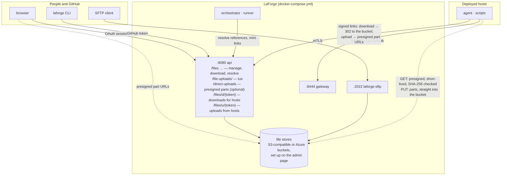

# Plan: the file store, on the 3.0 architecture

**Status:** proposal for `3.0`. **Written:** 2026-10-12, against `3.0` at `2227c778`.

LaForge stays one deployment — api, orchestrator, runner, gateway, Postgres, in one
compose stack — and gains a place to keep the files content uses, ways to get files in,
a way for hosts to fetch them, and a way for hosts to send files back. This supersedes
§9 of [site-split-and-file-store.md](site-split-and-file-store.md) for `3.0`; nothing
here depends on that plan's cloud/site split.

## Contents

1. [What it is for](#1-what-it-is-for)
2. [Shape](#2-shape)
3. [File stores](#3-file-stores)
4. [Data model](#4-data-model)
5. [Getting files in](#5-getting-files-in)
6. [Getting files to hosts](#6-getting-files-to-hosts)
7. [Getting files back from hosts](#7-getting-files-back-from-hosts)
8. [Configuration](#8-configuration)
9. [Security](#9-security)
10. [Operations](#10-operations)
11. [Phases](#11-phases)
12. [Open decisions](#12-open-decisions)

## 1. What it is for

A place to keep files that content uses — installers, tool archives, disk images,
datasets, wordlists, Compose project assets — from a few KB to several GB:

- **Uploaded once**, through the UI, the CLI or SFTP, resuming when a connection drops.
- **Managed in the UI**: versions, rename, soft delete and restore, who did what, what
  content uses each file, how much each repository holds.
- **Referenced from content by name**: `download: { file: tools/nmap.tgz }` in a step,
  `{{ file "wordlists/rockyou.txt" }}` in a script. Validated when content is pushed, so a
  build never starts with a reference to a file that isn't there.
- **Fetched by hosts** over a signed link that only works for that build.
- **Sent back by hosts**: the `upload:` step (today "not implemented — no file store
  yet" in `internal/gateway/steps.go`) puts logs, generated credentials and evidence into
  the file store under the build, one-time links only, never at a player's initiative.

Not in scope here: anything that needs a second machine (on-site caches, replication).

## 2. Shape



Two new things listen: the api gains the file routes, and `laforge-sftp` is a new small
service on 2022 (optional; leave it out of the stack if nobody wants SFTP). Hosts already
reach the api today for their agent binary (`API_PUBLIC_URL`); download and upload links
use the same address, but **only for authorisation**: a host's download link answers with
a redirect to the bucket, and a host's upload link answers with presigned part URLs on
the bucket. No file byte passes through the api in either direction unless a store's
*proxy* setting is turned on for a venue that can't reach its bucket. The only bytes
the api ever stages are people's tus uploads (§5), and those can go direct too. Nothing
new is published.

## 3. File stores

**Bytes** live in object storage you bring — never on LaForge's own disk, which would make
LaForge the thing that needs the storage and the bandwidth. A deployment has one or more
**file stores**, set up and managed on an admin page, **Admin → File stores**, the way
builders are (a list, a form per kind, a *Test* button, edit and delete):

| Kind | Settings | Credential |
| --- | --- | --- |
| **S3-compatible** — AWS S3, Cloudflare R2, Backblaze B2, MinIO, SeaweedFS… | bucket, region, endpoint (blank for AWS), path-style on/off, a key prefix | access key id + secret |
| **Azure Blob** | storage account, container, a prefix | account key (or a SAS token) |

Each store also carries the policy that applies to what it holds — one place, not a
dozen environment variables: maximum file size (default 50 GiB), quota per scope
(default none), versions kept per file (5), retention of deleted files (30 days),
whether browsers may upload straight to it (§5; S3 only, needs a CORS rule exposing
`ETag`), how long a download redirect's presigned URL lives (15 minutes), and whether
the api should stream downloads itself for hosts that can't reach the bucket (§6).

**Adding one is a wizard**, like adding a builder (`/admin/file-stores/new`; *Edit*
reopens it at any step):

1. **Kind** — S3-compatible or Azure Blob, with a line on what each needs (a bucket and
   an access key with get/put/delete/list on it; a container and an account key).
2. **Connection** — the kind's settings and credential, and a **Test** that runs the
   round trip below live, showing each check as it passes (reachable → can write → can
   read with a range → can presign and fetch anonymously → can delete). Nothing is saved
   until the test passes once; a store that can't do all of this can't be used.
3. **Policy** — the limits and retention with their defaults filled in; *direct
   uploads* with the exact CORS rule to paste into the bucket (and the test re-run
   against it from the browser); *presign TTL*; *proxy downloads* with when to turn it on.
4. **Use** — make it the default (the first one is, automatically), and optionally point
   repositories at it now.

**Which store a file goes to.** One store is the **default**; a repository can be pointed
at another on its settings (a sponsor's own bucket, a region nearer a venue). New
uploads to a scope go to its store; `file_blob` remembers which store holds each object,
so re-pointing a repository affects only what's uploaded from then on, and nothing moves
by itself. The Files page shows each store's usage, and the store's page shows which
scopes use it.

**Testing a store** (`POST /file-stores/{id}/test`, like a registry credential's): write
a small object, read it back with a range, presign a GET and fetch it anonymously,
delete it — so a store that's reachable from the api but not presignable, or writable
but not readable, is caught at setup and not at a competition.

**Deleting a store** is refused while any `file_blob` lives in it; empty the scopes that
use it first (or move them — §12). **No lifecycle rules** on the bucket that delete
objects: LaForge's collector owns deletion.

**Credentials at rest** are stored in the database the way builder and registry
credentials are today (same trust model: the database is the secret store), write-only
over the API, redacted in every response, and only ever used server-side — a browser
gets presigned URLs, never a key.

**Development** needs a bucket too: the dev compose stack includes a SeaweedFS (or
MinIO) container, and the first-run page offers it as a one-click default store. The
test suite runs against the same (`LAFORGE_TEST_S3_URL`).

Objects are keyed by content, `<prefix>/sha256/<first 2>/<sha256>`, behind one
abstraction (`gocloud.dev/blob`, which covers both kinds): identical uploads are stored
once, renames are free, and everything a host fetches is verifiable.

## 4. Data model

**Names** live in Postgres:

| Table | What |
| --- | --- |
| `file_store` | a configured store: name, kind (`s3`, `azblob`), its settings as JSON, its credential, its policy (max file size, scope quota, versions kept, deleted-file retention, direct uploads, presign TTL, proxy downloads), `is_default`, created/updated by and at |
| `file_blob` | one row per distinct content: sha256, size, **store id**; garbage-collected once nothing references it |
| `file` | a named file in a **scope** — `repository_id` NULL is `global`, else that repository's — with a path unique (case-insensitively) among the scope's live files; description; soft-delete columns |
| `repository.file_store_id` | which store a repository's scope uploads to; NULL means the default store |
| `file_version` | each upload to a path adds one; the highest is current; sha256, size, content type, who, when |
| `file_upload` | an upload in progress: via `tus`, `sftp` or `direct`, scope and path, bytes so far, expiry; the api and the sftp service each resume and expire only their own |
| `file_event` | everything that happened to a file (upload, rename, delete, restore, version restore), for the file's history |
| `file_reference` | which files each content revision references (`download: { file }`, `{{ file }}`), with the pinned version or 0 for current; recorded at validation. Answers "used by" and protects a referenced version from pruning |
| `file_delivery_key` | the HMAC key that signs host download links; one row, made on first use |
| `host_upload` | an `upload:` step's grant: grant id, build, destination path, sha256 and size once received; one row per grant, so a used link takes nothing more |

**Scopes and permissions.** Instance admins manage `global`; a repository's `manage`
level manages its scope; anyone with `read` on a repository sees and downloads its files
and `global` ones. Resolution from content: the repository's own scope first, then
`global`.

**Versions.** The store's *versions kept* (default 5) older versions are kept per file,
plus any version that live content pins by `path@N`. A deleted file is kept the store's
*deleted-file retention* (30 days) for restore, then purged; blobs are collected when no
version references them.

**Quotas.** The store's *maximum file size* (50 GiB) per file and *quota per scope* (none
by default), checked before an upload starts *and* when it completes — host uploads
included (a host can't fill the store).

## 5. Getting files in

**tus over HTTP — the UI and the CLI.** `POST /file-uploads/` (tus 1.0.0, the `tusd`
library) with `Upload-Metadata` carrying scope, path and the file's SHA-256. Bytes are
staged on the api's disk (`FILESTORE_STAGING_DIR`), so a dropped connection resumes from
the server's `Upload-Offset`; once complete, the file is hashed, checked against the
client's hash and copied into object storage in the background (`finalizing`), and
`GET /file-uploads/{id}/status` says when the version exists. Staging keeps one code path
for every backend and keeps a multi-GB copy out of any single request a proxy could time
out.

- **UI**: a drag-and-drop uploader with progress, pause and resume; an upload's id is
  kept in `localStorage` under the file and destination, so choosing the same file again
  after a reload continues it.
- **CLI**: `laforge files put [scope:]path file` resumes the same way (`laforge files
  ls|get|rm|mv|versions|restore` round it out). `laforge check --online` asks the api
  (`POST /files/resolve`) that every reference in the content exists.

**Direct to the bucket — the default where the bucket allows it.** With *direct uploads*
on for the store, the browser uploads parts straight to the bucket through presigned multipart URLs
(`/direct-uploads`, `/direct-uploads/{id}/urls`, `…/complete`); the api only records
completion, then hashes and moves the assembled object into place. For when a many-GB
upload shouldn't pass through the api at all. Needs a CORS rule on the bucket that
exposes `ETag`.

**SFTP — `laforge-sftp`.** The file store as a filesystem on 2022: `/global/…`,
`/repos/<owner>/<repo>/…`. Authentication is the SSH public keys on the user's GitHub
account (`github.com/<login>.keys`, cached), for accounts LaForge already knows; the same
permissions as the UI. Writes stage like tus and finish on close; `reput` continues an
open upload at its offset. Reads stream from the bucket with ranges. `ls`, `rename`,
`rm`, `mkdir` map onto file records.

## 6. Getting files to hosts

**References in content** (a `FileResolver` in `internal/render`, with a syntax-only
implementation for offline tools):

```yaml
steps:
  - download: { file: tools/nmap-7.95.tgz, to: /opt/nmap.tgz }
```

```bash
curl -fsSLo /tmp/wordlist.txt '{{ file "wordlists/rockyou.txt" }}'
echo '{{ fileSHA256 "wordlists/rockyou.txt" }}  /tmp/wordlist.txt' | sha256sum -c -
```

`{{ file "path" }}` / `{{ file "path@3" }}` render to a link; `{{ fileSHA256 }}` and
`{{ fileSize }}` describe the version. A file's SHA-256 is part of every referencing
object's fingerprint, so replacing a file redeploys the hosts that use it (as editing a
script does today); pinning `@N` opts out. Validation at push records `file_reference`
and fails content that names a missing file; offline `laforge check` checks the syntax.

**The link**: `<API_PUBLIC_URL>/files/d/<token>` — an HMAC over (file version, build)
with `file_delivery_key`, deterministic (a render doesn't change the URL every time), no
login, **410 once the build is torn down**. Anyone who can read a host's steps can read
its links; the files are meant for that host.

**The bytes come from the bucket, not through the api.** The link is LaForge's so it
can be signed once, stay stable in rendered scripts, and die with the build — none of
which a bucket URL can do (presigned URLs expire on a clock and can't be revoked). But
the api needn't carry the bytes: on a signed, live link it answers **302 to a presigned
GET** on the object (the store's *presign TTL*, default 15 minutes — long enough for one
download, short enough to be useless later), and the host streams from the bucket with
ranges. The api streams the bytes itself only when the store's *proxy downloads* is on,
for a venue whose hosts can reach the api but not the bucket's host. Either way the
response carries `ETag` and `X-Content-SHA256`, and ranges work. The Files page's own
downloads use the same redirect.

**The agent** (`download:` step) follows the link, checks the SHA-256 the step payload
carries, and resumes with a `Range` after an interruption (asking the api again if the
presigned URL has expired). Over HTTPS when `API_PUBLIC_URL` is HTTPS; the agent trusts
the system roots for it and for the bucket (both sit behind real certificates in any
deployment that isn't a laptop), and the hash check covers integrity either way.
Scripts' `curl -L`/PowerShell fetches follow the redirect the same way.

## 7. Getting files back from hosts

```yaml
steps:
  - upload: { from: /var/log/setup.log }                       # → uploads/<env>/<build>/team03/web01/setup.log
  - upload: { from: 'C:\Users\Public\creds.txt', to: loot/creds.txt }
```

- **Where it lands**: the build's repository scope, under
  `uploads/<environment>/<build>/team<NN>/<host>/…` — a host can't write anywhere else.
  Listed on the build's Artifacts tab and the Files page like any file.
- **One-time links, never at a player's initiative.** When the step is dispatched (a
  deploy step, a scheduled task — a fresh grant each firing — or an ad-hoc command), the
  orchestrator mints a grant: a random id plus the build and destination, signed into a
  token the step payload carries as `<API_PUBLIC_URL>/files/u/<token>`. The grant is used
  up when the upload completes; anything sent on it afterwards is refused. Nothing a
  player does on the host can make LaForge ask for a file.
- **Straight into the bucket.** The same mechanism as the browser's direct uploads
  (§5), with the grant in place of a session: the agent `POST`s the link with the file's
  size and SHA-256 and gets back the part size and a presigned URL per part (S3
  multipart; Azure block SAS URLs); it `PUT`s the parts to the bucket, in parallel,
  retrying each; `GET` on the link says which parts the bucket already has, so an
  interrupted upload resumes from there; `POST …/complete` has the api finish the
  multipart upload and record the file. The api sees headers, never bytes. Presigned
  part URLs live an hour and name one part of one object; there's no bucket credential
  on the host.
- **Not content-addressed.** A host's upload is stored under its own key,
  `<prefix>/uploads/<build>/<grant>`, never under its hash — the api can't verify a hash
  it never streamed, and a key it can't verify must never be one a trusted file could
  share (a host declaring a trusted file's hash would otherwise overwrite what
  `{{ file }}` serves). The declared SHA-256 is recorded on the version as *declared*,
  shown as such, and checked by whoever downloads it; the agent additionally sends S3's
  per-part `x-amz-checksum-sha256`, which the bucket enforces, so corruption in transit
  is caught there.
- **Quota** is checked against the declared size before part URLs are issued, and the
  object's real size when it completes; abandoned multipart uploads are aborted by
  housekeeping after 24 h. A store with *proxy* on takes the parts through the api
  instead, for a venue whose hosts can't reach the bucket.

## 8. Configuration

Stores and their policy live in the database (§3), so the environment keeps only what
has to be there before the database is reachable or is about the machine itself:

```
FILESTORE_STAGING_DIR=/var/lib/laforge/staging      # uploads in flight on the api's disk (the sftp service has its own)
FILESTORE_UPLOAD_EXPIRY_HOURS=168                   # abandoned uploads
API_PUBLIC_URL=https://laforge.example.com          # exists today: what hosts reach the api at (links only; bytes go to the bucket)
SFTP_LISTEN_ADDR=:2022  SFTP_HOST_KEY=/var/lib/laforge/sftp/host_key   # laforge-sftp
```

With no store configured, the Files page says so and points at Admin → File stores;
`{{ file }}` references fail validation with the same message; nothing else changes.

## 9. Security

- **Links in the path, nothing in query strings**; tokens are HMAC with a key that never
  leaves the database. A download link grants one version to one build and dies with
  the build; an upload link grants one destination for one upload and dies on use.
- **Hosts can't enumerate or browse**: no listing route is reachable without a session.
- **Quota and size limits** apply to host uploads, so a hostile host can't fill the store;
  partials are capped at the per-file maximum and pruned.
- **People's uploads are verified** against the SHA-256 the client declared before a
  version appears; a mismatch discards the bytes. **Hosts' uploads are never
  content-addressed** (§7), so a hostile host can't overwrite or alias anything a
  trusted file serves.
- **Permissions** follow the repository's existing levels; `global` is instance-admin.
- **Store credentials** are write-only over the API, redacted in responses, and never
  reach a browser or a host; a presigned URL is what leaves.
- **Agent downloads** verify the SHA-256 from the step payload (delivered over mTLS), so
  a plain-HTTP `API_PUBLIC_URL` still gives integrity, just not confidentiality — use
  HTTPS for anything that matters. A presigned bucket URL is short-lived and names one
  object; it carries no bucket credential.

## 10. Operations

- **Housekeeping** (api, hourly): expire abandoned uploads and their staging files; purge
  deleted files past retention; prune versions past `KEEP_VERSIONS` that no content
  pins; collect unreferenced blobs; prune host-upload partials older than 24 h.
- **Usage**: the Files page shows bytes per scope against its quota (`GET /files/usage`).
- **Backups**: the database and the buckets together; a restored database with a bucket
  that moved on just has dangling `file_blob` rows the collector resolves. The store
  credentials are in the database backup — treat it accordingly.
- **Tests** run against an S3-compatible server (`LAFORGE_TEST_S3_URL`; SeaweedFS in a
  container), the same one the dev compose stack provides.

## 11. Phases

| Phase | Size | What | Done when |
| --- | --- | --- | --- |
| **F1 Stores and API** | M | `file_store` and the Admin → File stores page (S3, Azure; test, default, per-repository choice), `internal/filestore` behind `gocloud.dev/blob`, migration `00050`, management routes, tus uploads, housekeeping, `file_reference` at validation, the Files page and `laforge files`; SeaweedFS in the dev compose | a store set up on the page passes its test; a file uploaded through the UI (and resumed after a kill) appears with its version in that store, "used by" lists the content that names it, and `laforge check --online` fails a push naming a missing file |
| **F2 Delivery** | S | `/files/d/{token}` on the api (302 to a presigned GET, or the bytes when the store proxies), `{{ file }}`/`download:` resolution in the orchestrator, fingerprints, the agent's download with resume and hash check | a fake-builder host downloads a file by reference straight from the bucket, a replaced file redeploys it, a torn-down build's link answers 410, an expired presigned URL is re-fetched through the link |
| **F3 Host uploads** | M | `host_upload`, grants minted at dispatch, `/files/u/{token}` issuing and completing presigned multipart uploads, the agent's part uploader with resume, the Artifacts tab | an `upload:` step lands under the build straight from the host to the bucket, resuming after a dropped connection; a second send on the same link is refused; a player-minted link is refused; a declared hash matching a trusted file changes nothing that file serves |
| **F4 SFTP** | S | `laforge-sftp`, compose service, docs | an OpenSSH upload cut off mid-way and finished with `reput` comes back with the same SHA-256 |
| **F5 Direct uploads** | S | the store's *direct uploads* setting, presigned parts, abandoned-multipart cleanup | a browser upload to a bucket survives a reload |

F1 → F2 → F3 in order (F3 reuses F5's presigned-part mechanism, so F5 comes before F3
or with it); F4 any time after F1.

## 12. Open decisions

- **Agent TLS for downloads.** The agent trusts the system roots for `API_PUBLIC_URL`
  and the bucket. If a deployment's api sits behind a private CA, the agent would need
  that CA delivered with its identity at first boot.
- **Hosts that can't reach the bucket.** *Proxy downloads* is per store; a per-builder
  setting would let one venue proxy while others go direct from the same store.
- **Moving a scope between stores.** Re-pointing a repository only affects new uploads.
  A "move" that copies its blobs to the new store and updates `file_blob` is a
  background job worth having once there are two stores; until then, deleting a store
  means emptying it first.
- **Retention of host uploads.** They count against the repository's quota and are
  never pruned on their own; a build's teardown could offer to delete its `uploads/`
  folder.
